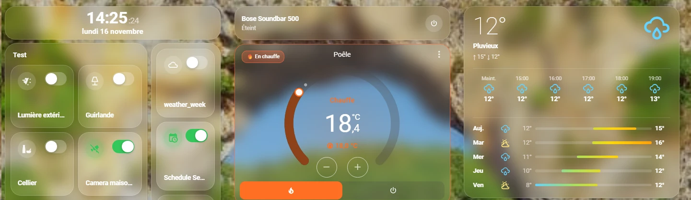
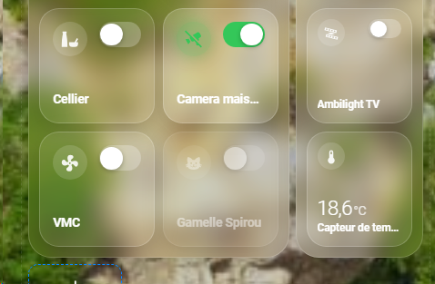
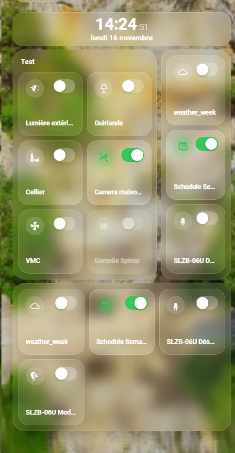
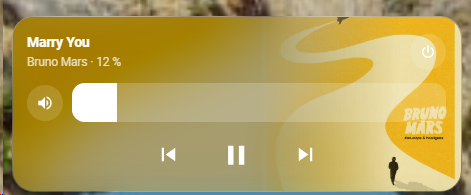
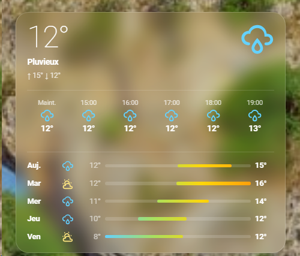
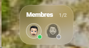

# Glass Card

Des cartes **glassmorphism** pour Home Assistant : effet verre dépoli, coins arrondis, toggles façon iOS. Éditeur visuel pour chaque carte, aucune dépendance.



| Carte | Rôle |
|---|---|
| `glass-card` | Une tuile : interrupteur, lumière, capteur… |
| `glass-grid-card` · `glass-grid-1-card` · `glass-grid-3-card` | Tuiles carrées regroupées (2, 1 ou 3 colonnes), titre optionnel |
| `glass-thermostat-card` | Thermostat natif habillé en verre, avec pastille d'état |
| `glass-clock-card` | Heure, date et fête du jour |
| `glass-media-card` | Lecteur média : pochette floutée, volume façon Apple |
| `glass-weather-card` | Météo façon Apple : maintenant, heure par heure, semaine |
| `glass-members-card` · `glass-members-badge` | Présence des membres de la maison (carte ou badge) |

## Installation

### Via le Marketplace (Home Assistant 2026.11 et plus)

1. **Paramètres → Marketplace** → ⋮ → **Dépôts personnalisés**
2. URL : `https://github.com/mrcouscous49-ui/glass-card` — Type : **Tableau de bord** (Dashboard)
3. Cherchez **Glass Card** → **Télécharger**
4. Rechargez la page (Ctrl+F5)

Sur une version plus ancienne de Home Assistant, c'est la même chose depuis **HACS**.

### Manuelle

1. Copiez `glass-card.js` dans `/config/www/`
2. Paramètres → Tableaux de bord → ⋮ → **Ressources** → Ajouter `/local/glass-card.js` (type *Module JavaScript*)

## Glass Card (une tuile)

| Type d'entité | Affichage | Appui court | Appui long |
|---|---|---|---|
| `switch`, `light`, `fan`, `input_boolean`, `automation`, `siren`, `humidifier` | icône + toggle + nom + état | allume / éteint | fenêtre de détail |
| Tout le reste (`sensor`, `binary_sensor`, `climate`…) | icône + valeur + nom | fenêtre de détail | fenêtre de détail |

Pour une lumière allumée, l'accent prend la vraie couleur de l'ampoule et la luminosité s'affiche (`Allumé · 80 %`).

Pour un capteur (température, humidité, consommation…), la tuile affiche sa valeur en grand à la place de l'interrupteur, seule ou dans une grille au milieu des boutons :



Modifier le dashboard → **Ajouter une carte** → cherchez **Glass Card** → choisissez votre entité.

En YAML :

```yaml
type: custom:glass-card
entity: switch.guirlande
```

```yaml
type: custom:glass-card
entity: sensor.salon_temperature
name: Salon
icon: mdi:thermometer
color: [255, 149, 0]
blur: 20
opacity: 12
```

## Options

| Option | Type | Défaut | Description |
|---|---|---|---|
| `entity` | string | **obligatoire** | L'entité à afficher |
| `name` | string | nom de l'entité | Nom affiché |
| `icon` | string | icône de l'entité | Ex. `mdi:lamp` |
| `square` | booléen | `true` | Tuile carrée, de la même taille que celles des grilles. `false` : rectangle 6 × 2 |
| `icon_on` | string | = `icon` | Icône affichée quand c'est allumé (ex. `mdi:video` / `mdi:video-off`) |
| `color` | `[r, g, b]` | vert iOS `[52, 199, 89]` | Couleur d'accent (toggle et icône actifs) |
| `blur` | nombre (px) | `15` | Intensité du flou derrière la carte |
| `opacity` | nombre (%) | `10` | Opacité du verre |
| `show_state` | booléen | `true` | Affiche l'état sous le nom (interrupteurs) |
| `icon_glow` | booléen | `true` | L'icône s'illumine de la couleur d'accent quand c'est allumé. `false` : l'icône reste blanche, seul l'interrupteur se colore |

## Glass Grid Card : plusieurs interrupteurs dans un bloc

Regroupe plusieurs tuiles dans un seul bloc de verre. Dans l'éditeur visuel, il suffit de choisir les entités.



```yaml
type: custom:glass-grid-card
columns: 2
icon_glow: false
entities:
  - switch.cellier
  - fan.vmc
  - entity: light.exterieur
    name: Lumière ext.
    icon: mdi:outdoor-lamp
```

Capteurs et interrupteurs peuvent être mélangés dans la même grille :

```yaml
type: custom:glass-grid-card
title: Salon
entities:
  - sensor.salon_temperature
  - sensor.salon_humidite
  - switch.guirlande
  - light.salon
```

Chaque entité peut être un simple id, ou un objet avec `entity`, `name`, `icon`, `icon_on`, `color`, `icon_glow`, `show_state` pour la personnaliser.

| Option | Type | Défaut | Description |
|---|---|---|---|
| `entities` | liste | **obligatoire** | Les entités à afficher |
| `title` | string | aucun | Titre affiché en haut du bloc (pour classer : « Extérieur », « Cuisine »…) |
| `columns` | nombre | `2` | Nombre de tuiles par ligne (1 à 4) |
| `square` | booléen | `true` | Tuiles carrées, bloc ajusté au contenu. `false` : tuiles étirées sur toute la hauteur du bloc |
| `color`, `blur`, `opacity`, `icon_glow` | | comme ci-dessus | Appliqués à tout le bloc |
| `show_state` | booléen | `false` | Affiche l'état sous chaque nom |

Deux variantes sont aussi dans le sélecteur de cartes, mêmes options :

| Carte | Colonnes | Largeur par défaut |
|---|---|---|
| `custom:glass-grid-1-card` | 1 (liste verticale) | 4 / 12 |
| `custom:glass-grid-card` | 2 | 8 / 12 |
| `custom:glass-grid-3-card` | 3 | 12 / 12 |

Les largeurs sont choisies pour que les tuiles aient la même taille d'une carte à l'autre (gardez « taille recommandée » activé dans *Mise en page*).

Dans l'éditeur visuel, chaque entité a son volet dépliable pour changer son **nom**, son **icône** et son **icône quand allumé**.

## Glass Thermostat Card

Le cadran thermostat natif de Home Assistant (consigne, + / −, modes) habillé en verre, avec une **pastille d'état** et un contour qui change de couleur :

| Pastille | Couleur | Quand |
|---|---|---|
| En chauffe | orange | le chauffage tourne |
| Refroidit | bleu | la climatisation tourne |
| Consigne atteinte | vert | température actuelle ≥ consigne |
| En attente | jaune | allumé, sous la consigne, mais pas en chauffe |
| Éteint | gris | mode arrêt ou appareil indisponible |

```yaml
type: custom:glass-thermostat-card
entity: climate.poele
name: Poêle
show_modes: true
```

| Option | Type | Défaut | Description |
|---|---|---|---|
| `entity` | string | **obligatoire** | Une entité `climate.*` |
| `name` | string | nom de l'entité | Nom affiché |
| `show_modes` | booléen | `true` | Boutons de mode sous le cadran (chauffage, arrêt…) |
| `blur`, `opacity` | | `15`, `10` | Comme pour les autres cartes |

## Glass Clock Card

L'heure et la date, chaque élément activable, avec la **fête du jour** (calendrier français intégré, aucun service externe).

```yaml
type: custom:glass-clock-card
show_weekday: true
show_date: true
show_year: false
show_seconds: false
show_saint: true
```

Le format 12 / 24 h et le fuseau horaire suivent le profil de l'utilisateur dans Home Assistant.

## Glass Media Card



Lecteur média sans dépendance : titre, artiste et volume, barre de volume façon Apple (glisser pour régler), boutons précédent / lecture / suivant et pochette d'album floutée en fond.

Fonctionne avec n'importe quelle entité `media_player` : barre de son (Bose, Sonos…), enceinte AirPlay, Apple TV, Chromecast, Spotify… Choisissez simplement l'entité dans l'éditeur.

```yaml
type: custom:glass-media-card
entity: media_player.salon
```

| Option | Défaut | Description |
|---|---|---|
| `show_volume` | `true` | Barre de volume et bouton muet |
| `show_controls` | `true` | Boutons précédent / lecture / suivant |
| `show_artwork` | `true` | Pochette floutée en fond pendant la lecture |
| `show_power` | `true` | Bouton marche / arrêt |

Les boutons s'adaptent à ce que l'appareil supporte, et sont masqués quand il est éteint. Un appui sur le titre ouvre le détail.

## Glass Weather Card



Météo façon Apple : température actuelle, condition, min / max du jour, détails, prévisions heure par heure et sur plusieurs jours avec barres de températures.

```yaml
type: custom:glass-weather-card
entity: weather.maison
hours: 6
days: 5
```

| Option | Défaut | Description |
|---|---|---|
| `show_details` | `true` | Ressenti, humidité, vent |
| `show_hourly` / `hours` | `true` / `6` | Prévisions par heure |
| `show_daily` / `days` | `true` / `5` | Prévisions par jour |

## Glass Members Card



Les membres de la maison : photo de chaque personne, pastille **verte** quand elle est à la maison (grise et photo en noir et blanc sinon), et compteur `présents / total`. Un appui sur un avatar ouvre le détail de la personne.

```yaml
type: custom:glass-members-card
title: Membres
entities:
  - person.alice
  - person.bob
```

| Option | Défaut | Description |
|---|---|---|
| `entities` | **obligatoire** | Les entités `person.*` (ajoutées depuis l'éditeur visuel) |
| `title` | `Membres` | Titre de la carte |
| `show_count` | `true` | Compteur présents / total |
| `blur`, `opacity` | `15`, `10` | Comme pour les autres cartes |

Sans photo de profil, l'initiale du nom s'affiche.

**En badge** (rangée du haut d'une vue sections) : Modifier → **Ajouter un badge** → *Glass Members Badge*, mêmes options.

```yaml
badges:
  - type: custom:glass-members-badge
    entities:
      - person.alice
      - person.bob
```

> Astuce : l'effet verre se voit le mieux sur un dashboard avec une image de fond.

## Licence

MIT
